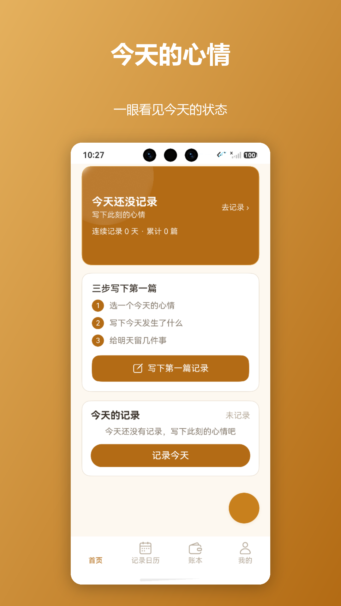
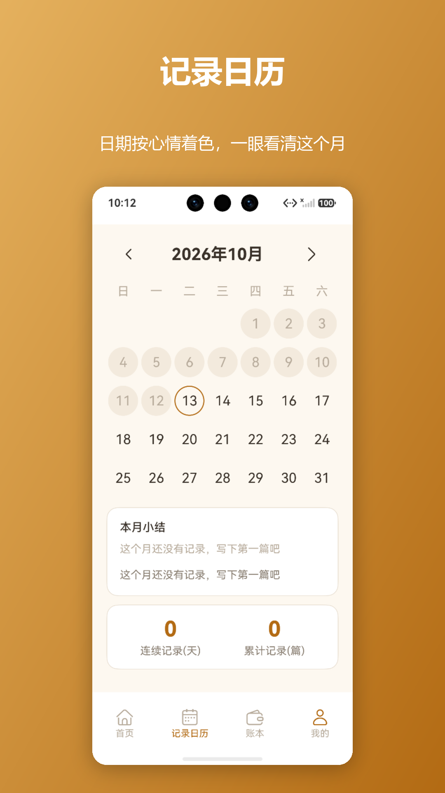
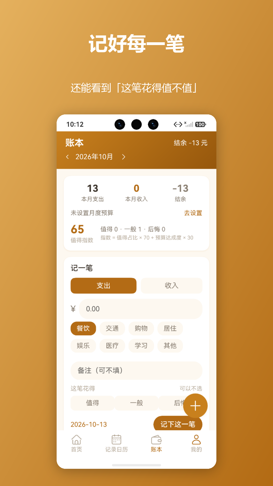
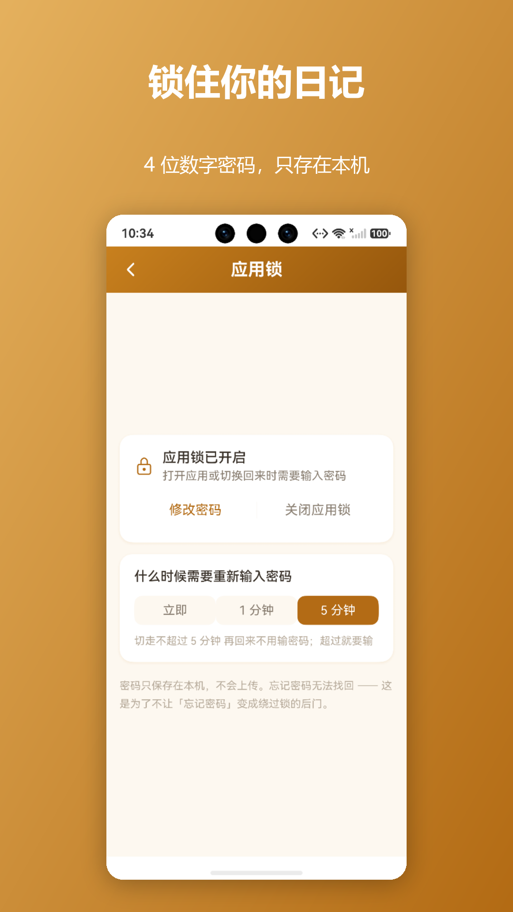

# 心情手记（MoodJournal）

一款**完全离线**的 HarmonyOS 个人心情日记与生活记录应用，已在华为应用市场上架。

不需要注册、不需要联网、没有广告。所有数据只保存在本机。

> 应用名：心情手记 · 包名 `com.datelog.couple` · 当前版本 1.7.2（versionCode 1000012）

[](LICENSE)
[](https://github.com/D-sp-wq/moodjournal/actions/workflows/hygiene.yml)


**目录**

- [截图](#截图)
- [功能](#功能)
- [工程实现要点](#工程实现要点)
- [技术栈](#技术栈)
- [目录结构](#目录结构)
- [构建](#构建)
- [仓库自检](#仓库自检)
- [更新日志](#更新日志)
- [后续计划](#后续计划)
- [隐私](#隐私)
- [许可证](#许可证)

---

## 截图

| 首页 | 记录日历 | 账本 | 应用锁 |
|---|---|---|---|
|  |  |  |  |

---

## 功能

**记录**
- 每日心情：6 种预设 + 自定义心情
- 每天最多 3 张照片
- 日记正文（自动统计累计字数）
- 「明天要做的事」，次日打开应用时在首页回显
- 标签：每条记录最多 3 个标签，可删除、可重复使用

**回看与查找**
- 记录日历：日期按当天心情着色，有照片/有安排的日期带标记，附本月小结
- 时间轴：按时间倒序回顾，点击进详情
- 记录详情：正文、照片、计划、标签只读回看
- 全文搜索：关键字高亮，并支持按**心情 / 时间范围 / 是否有照片 / 标签**组合筛选
- 历史封存：一天过去后记录只读，空白的历史日期不可补记

**分析与回顾**
- 心情趋势：近 30 天色条 + 折线
- 数据统计：篇数 / 天数 / 覆盖率 / 连续记录 / 字数 / 心情分布 / 近 6 个月柱状图
- 本周回顾、近 30 天回顾：自动生成总结并与上一个周期对比
- 年度报告：自然年分桶，12 个月分布 + 心情分布 + 最长连续记录

**生活管理**
- 习惯打卡：一天一格，连续天数与 30 天完成率
- 任务规划：自动算目标完成日、剩余天数与进度
- 账本：支出 / 收入 / 月度预算 / 分类占比，支出可标记「值得 / 一般 / 后悔」，得出月度**值得指数**与心情-花费关联洞察
- 未来日程：给未来某天安排要做的事，汇总到首页「接下来几天」
- 重要日子：倒计时与提醒

**其他**
- 数据导出与恢复：导出 TXT / JSON 备份，可一键还原
- 应用锁：4 位数字密码，可选立即 / 1 分钟 / 5 分钟后重新验证
- 日夜模式、桌面卡片、图库

---

## 工程实现要点

这个项目在"能跑"之外，刻意做了几件工程上的事：

**1. 业务计算全部抽成可测试的纯函数**
统计、心情趋势、周报、月度回顾、日历标记、账本洞察、消费分析、年度报告等全部放在 `entry/src/main/ets/models/` 下，
不依赖存储与 UI，因此可以直接单元测试。**单元测试 288 条全绿**。

**2. 数据库版本迁移**
`DatabaseHelper` 自建 `DB_VERSION` + `ALTER TABLE` 迁移机制，从 v3 迭代到 v6（新增自定义心情、照片、记录标记、账本感受、标签等列）。
每次迁移都为历史数据设默认值，保证**版本升级不丢数据**；读取时对"列不存在 / 值为 NULL"做兜底。

**3. 零权限的隐私设计**
- 不申请网络权限，应用**不具备联网能力**
- 相册与文件都走系统选择器（`PhotoViewPicker` / `DocumentViewPicker`），不申请存储权限
- 包内 `pac.json` 声明为 `{"dataProcess":[],"specialAPIs":[]}`
- 隐私政策（`docs/store/privacy-policy.html`）与实现保持一致

**4. 自控发布签名流水线**
`tools/sign_release.ps1` 完全脱离 DevEco 的"自动生成签名"：
构建未签名包 → 解包 → 签 hap → 装回重打包 → 签 app → 官方 `hap-sign-tool` 验签。
配 `tools/check_signing.py` 做上架前自检，判据是**三张证书公钥一致 + 包内嵌 Profile 的 uuid 匹配**。

**5. 记录"为什么这么做"**
`docs/store/RELEASE_RUNBOOK.md` 记录了完整上架流程与踩过的坑（例如错误码 993 的成因是调试证书 ≠ 发布证书）。

---

## 技术栈

HarmonyOS · ArkTS · ArkUI 声明式 UI · RelationalStore（SQLite）· ArkUI 系统符号库（`SymbolGlyph`）· AppGallery Connect

---

## 目录结构

```
entry/src/main/ets/
├── models/          # 纯函数业务模型（可单测）
├── pages/           # 页面（@Entry）
├── components/      # 复用组件（图标、心情色点、月历等）
├── services/        # 存储、数据访问、导出/导入、主题
│   ├── data/        # 仓储层（Repository + LocalRepository）
│   └── storage/     # 数据库、偏好、应用锁、主题
└── entryability/    # 应用入口、导航条避让、锁屏门禁

entry/src/test/      # 288 条单元测试
tools/               # 签名流水线、自检、商店素材生成
docs/                # 上架文档、隐私政策、商店素材
```

---

## 构建

前置：DevEco Studio（本项目使用 API 26 / `compatibleSdkVersion 6.1.1(24)`）

```bash
# 复制并配置签名（仓库不含真实的 build-profile.json5，原因见该模板文件里的说明）
cp build-profile.json5.example build-profile.json5

# 编译
hvigorw assembleHap --mode module -p product=default --no-daemon

# 单元测试
hvigorw test --mode module -p product=default --no-daemon
# 结果：entry/.test/default/intermediates/test/coverage_data/test_result.txt
```

用 DevEco Studio 直接打开工程也可以（首次会提示配置签名）。

---

## 仓库自检

仓库里带了一个不依赖 HarmonyOS SDK 的健康检查脚本，GitHub Actions 每次推送都会跑（见 [.github/workflows/hygiene.yml](.github/workflows/hygiene.yml)），本地也可以手动执行：

```bash
python tools/check_repo_hygiene.py
```

它检查三类**本项目真实踩过的坑**：

| 检查 | 为什么需要 |
|---|---|
| 签名材料 / 口令 / 本机用户名路径是否混进版本控制 | 签名口令曾以明文写在脚本里；工具脚本里曾有本机绝对路径 |
| 测试文件是否都注册进了 `List.test.ets` | 该文件是唯一测试入口，漏注册的用例会"存在但从不运行"，测试看着全绿实际有覆盖空洞 |
| `versionCode` 是否大于已上架版本 | 应用市场要求每次上架的版本号严格递增，否则直接拒绝 |

> CI **不做编译**：HarmonyOS 编译需要 DevEco Studio 与 SDK，托管 runner 上没有这套环境。
> 编译与单元测试在本地执行（`hvigorw assembleHap` / `hvigorw test`）。

---

## 更新日志

各版本的新增、优化与工程变更记录在 [CHANGELOG.md](CHANGELOG.md)。

---

## 后续计划

这些是已知可以改进、但尚未排期的方向：

- **补全页面底部安全区**：内容较短的页面在整屏 `Scroll` 中会被垂直居中，顶部留白偏大（应用锁设置页最明显）
- **`LogDetailPage` 支持编辑标签**：目前详情页只读展示，增删标签需回到记录页
- **界面自动化测试**：现有 288 条都是纯函数与逻辑层测试，UI 交互仍靠真机人工验证
- **平板 / 折叠屏适配**：目前只针对手机布局

---

## 隐私

- 应用不联网、不上传任何数据
- 不包含任何第三方广告、统计或数据分析组件
- 无第三方依赖
- 完整说明见 [隐私政策](docs/store/PRIVACY_POLICY.md)

---

## 许可证

[MIT](LICENSE) © 2026 D-sp-wq

可自由使用、修改、分发，保留版权声明即可。
